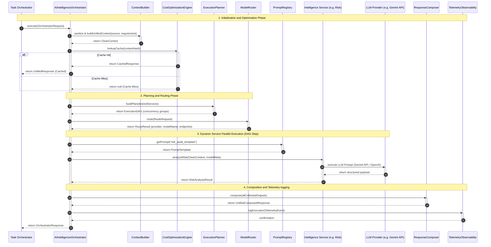

# AZIZ AI KERNEL: OPERATIONS SEQUENTIAL ORCHESTRATION
## AI OPERATIONS SEQUENCE DIAGRAM (SPRINT 10B DESIGN)

---

### Mermaid Execution Flow Diagram

---

### Step-by-Step Chronological Flow Explanation

#### 1. Context Optimization & Cache Lookup
- **Step 1**: The high-level **Task Orchestrator** triggers the main `execute` entrypoint on the `AIIntelligenceOrchestrator` containing raw source profiles and processing rules.
- **Step 2**: The **ContextBuilder** runs sanitization routines, stripping whitespaces, removing duplicate nodes, and building a high-density, clean context payload.
- **Step 3**: The orchestrator hashes the context and calls the **CostOptimizationEngine** to check for a valid cache hit. If hit, the orchestrator returns the cached response immediately, bypassing LLM processing costs.

#### 2. Planning & Model Selection
- **Step 4**: Upon a cache miss, the **ExecutionPlanner** sorts the desired services topologically, producing an execution DAG grouping independent processes (such as confidence evaluations and risk audits) into concurrent slots.
- **Step 5**: The **ModelRouter** evaluates the target capability classification, latency graphs, and token estimation indices, routing the execution to the optimal LLM provider and model (such as Gemini Flash).

#### 3. Parallel Execution & Template Dynamic Injections
- **Step 6**: The orchestrator fetches parameterized prompt templates from the centralized **PromptRegistry** rather than hardcoding prompts within services.
- **Step 7**: The Orchestrator parallelizes executions in accordance with the planner's concurrent groups. It dispatches calls to the respective intelligence services, supplying the active model metadata.
- **Step 8**: The active services interpolate context parameters into the retrieved prompts, invoking the resolved LLM provider.
- **Step 9**: The LLM Provider returns the structured JSON, which the services parse and return to the orchestrator.

#### 4. Unified Composition & Telemetry
- **Step 10**: The orchestrator passes the completed service responses to the **ResponseComposer** to compile them into a unified schema and calculate an integrated score.
- **Step 11**: The orchestrator registers performance profiles (token usage, duration curves, cache rates, model metadata) with the **TelemetryObservability** engine in a non-blocking background queue.
- **Step 12**: The fully composed and logged `OrchestratorResponse` is returned to the **Task Orchestrator** to render the dynamic user dashboard.
